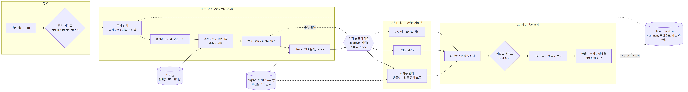

# 쇼츠 설계도 — 통합 설계서 (v1 ~ v15)

기준일 2026-11-02. 지금까지 쌓인 분석(v1~v13)과 구현을 **한 문서로 합친 정본**이다. 세부는 각 문서·규칙 파일을 가리킨다.
이 문서의 수치 중 성과·수익·강의 수치는 **사용자가 전달한 값이며 검증하지 않았다**(한 채널의 사례, 목표값 아님).



## 0. 버전 지도

| 버전 | 주제 | 반영 위치 |
|---|---|---|
| v1 | 영드짜 무료판 분석, 스킬+규칙 분리, 구성 7종, 레이더 개념 | `skills/`, `rules/`, `docs/04` |
| v2 | 링크 입력→작품 매칭→원본 확보, 작업 상태머신, 제작 현황 패널, 제작 옵션 | `docs/01`, `docs/03` |
| v3 | 원본·유튜브 → 캡컷 마무리, 권리 필드(`origin`/`rights_status`), 디스크 | `docs/01`, `docs/02`, `common` §9 |
| v4 | (사용자 전달 라벨 없음 — v5 문서가 "흐름과 TTS 분리 구조"를 앞서 정했다고 언급, 내용 미확인) | — |
| v5 | TTS(MiniMax) 비트별 생성, 실측 길이, 캡컷 배치 | `common` §10-2, `docs/06` |
| v6/v6.1 | 말하는 인물 중앙 + 프레임 꽉 채움 확대 | `engine/shortsflow.py` `crop_plan` |
| v7 | 제작 방식 3종(수동/자동/AI 위임) | `docs/06`, `docs/08` §1 |
| v8/v8.1 | 영상 보관함, 레이아웃 L1, 성과 지연, 업로드 게이트 | `docs/08` |
| v9 | 타율, 기획점 | `docs/08` §7 |
| v10 | AI 직원 구조(모델 배치), 저점 지표, 외부 분석 도구 | `docs/10` |
| v11 | 강의 "맛보기 3가지"(갈등 3유형, 정답 숨기기, 신작·명작·스타) | `docs/11`, `common` §1 |
| v12 | 꿀통레이더 모듈(인물선정·팬튜브·1분 카테고리) | `docs/12`, `rules/person-fantube.md` |
| v13 | 원클릭 제작 흐름(STEP 1~6, 제작 방식↔규칙 매핑, 자동 업로드 충돌 결정) | `docs/13` |
| v14 | 환경설정(계정·AI API·업로드 방식), 채널 관리(구글 계정·채널), 대기 큐, 제작 모드 기본 자동제작 | `docs/14`, `docs/13` §16 |
| v15 | 외부 강의 커리큘럼(1~4주차) 반영 분석, 겹침 분석 후 채택안(리스크 기록 신설, 나머지 기존 화면에 흡수) | `docs/15` |
| 추가 요청 | 민감 장면 처리, 플랫폼 정책 근거, 후킹타임 벤치마크, 기획 선행 게이트 | `common` §11·§0-2, `docs/05`, `docs/07` |

## 1. 제품 정의와 원칙

**한 줄 정의:** 원본 영상(+자막)에서 **쇼츠 한 편의 소재·후킹·제목·컷 설계·자막·나레이션**을 만들고, 승인된 기획으로 **영상까지 생성하거나 편집 도구로 넘기는** 시스템. 영상 생성 모델은 쓰지 않는다(원본 컷 편집).

핵심 원칙(규칙에 모두 잠금 또는 MUST로 들어 있다):
1. **기획 먼저, 영상은 승인된 기획의 결과물**(P0). 승인 없이, 또는 승인 뒤 컷표가 바뀌면 영상 생성 거부.
2. **구성 = 규칙 파일 한 벌.** 구성을 늘릴 때 코드를 바꾸지 않는다.
3. **판단은 모델·사람, 계산은 스크립트.** 시각·길이·크롭은 코드로, 같은 입력 → 같은 결과.
4. **업로드는 항상 사람이 승인.** 자동 업로드 기본 꺼짐.
5. **권리 확인 없이 업로드 없음.** `unverified` 는 영상 제작까지만.
6. **원작에 없는 사실을 지어내지 않는다**(R9-5).
7. **측정으로 규칙을 키우고 줄인다.** 강의·타 채널 수치는 가설이다.

## 2. 파이프라인

```
[입력] 원본+SRT → 권리 게이트 → 구성 선택(+채널 스타일) → 소재 모드
 → 줄거리(+민감 장면 표시) → 소재 3개(점수표) → 관문① → 흐름4줄·후킹·제목 → 관문②
 → 컷표.json(+meta.plan) → 민감 처리 설계 → check → TTS 계획·생성·실측 → recalc
 → ★기획 승인(approve, 사람)★
 → 영상: A render / B handoff / C delegate  (템플릿 + 얼굴 중앙 크롭)
 → 승인함 검수(수정 요청 → 기획 수정 → 재승인) → 업로드 게이트(사람) → 성과 → 타율·기획점 → 규칙 고정/삭제
```

### 상태머신 (`docs/01`)
`queued → matching → (need_source) → topic → building → review → approved → (scheduled) → done`, 예외: `blocked_disk`, `failed`, `canceled`. 모든 전이에 타임스탬프·로그(`job_events`). `scheduled` 는 `rights_status ∈ {own, licensed}` + 사람 승인일 때만.
영상 생성(`building`)은 **기획 승인 해시가 현재 컷표와 같을 때만** 시작한다(P0-2).

## 3. 규칙 체계 (`rules/`)

**운용:** MUST / SHOULD / 🔒(잠금: 어떤 구성도 못 바꿈), 규칙 ID로 인용, 어기면 `rule_exceptions` 기록.

### `common.md` 구성
| 절 | 내용 |
|---|---|
| §0-2 🔒 | **기획 선행(P0-1~4)** |
| §1 | 소재: 갈등 3유형, 소재 매력(신작·명작·스타), 점수표 100점(70점 미만 제외), C1-1~C1-10 |
| §2·§3 | 흐름 4줄, 시간순, 근거 장면, 후킹(0~3초) |
| §4 | 제목: 결과 숨김, 두 줄, 역할 표기, 글자 수 |
| §5 | 컷·나레이션·자막, **글자 수 기준표**, 자막 재계산 공식 |
| §6·§7 | 결말(펀치 끝음절+반응), 길이 20~59초 |
| §8 🔒 | 시각 정밀도(P8): SRT 근거, 이웃 줄 간격 중점, 확인 필요 경계 |
| §9 🔒 | 권리·정책 게이트(R9-1~6), 재사용·반복 콘텐츠 위험 |
| §10·§10-2 | 소리 마감, **TTS(A10-1~11)** |
| §11 🔒 | **민감 장면**: 19금·목조르기·칼 찌름·약물 투여 → 삭제/우회/가림, 음성 싱크 보호 |
| §12 | 공통 점검표 **28항** |

### 구성 파일
| 파일 | 용도 | 비고 |
|---|---|---|
| `drama.md` | 한드짜: 갈등→쌓임→뒤집힘 | 30~55초 |
| `drama-first-person.md` | 1인칭 한드짜 | 충돌 해결표 |
| `touching-reversal.md` | 감동 반전 | 오해·비밀 |
| `first-person.md` | 1인칭 나레이션 | 나레이션 40~55% |
| `variety.md` | 예능 | 20~40초 |
| `own-content.md` | **자체 보유 콘텐츠(1순위)** | 사실 표, 교육 맥락 |
| `person-fantube.md` | 인물·팬튜브·1분 카테고리 | **초안** |
| `indie.md` | 인드짜형 | **정의 전 슬롯** |
| `channel-hookingtime.md` | 채널 스타일 층(제목 꼬리 6종, 옵션 S-1~S-5) | 선택 |

### 소재 모드 (`modes/topic-modes.md`)
새 소재 / 같은 소재 / 같은 결 다른 소재 / 같은 결 같은 소재 · 다른 번역본(신규: en/ja 원본을 AI가 한국어로 재번역·의역) / 다른 결. 결 태그 13종(갈등 3유형 포함), 중복 방지(구간 겹침 40% 이하).

## 4. 소재·제목 설계

- **갈등 유형:** 누명·오해 / 들킬 위기 / 선택의 기로 / 그 외(무시→통쾌 등). 주 유형 1개 기록.
- **소재 매력:** 신작 / 명작 / 스타(작품 선정 태그).
- **제목:** `[역할] + [행동] + 꼬리`. 꼬리 6종: `~의 최후`, `~하면 생기는 일`, `~의 한마디`, `~한 이유/정체/과거`, `~한 진짜 이유`, `~한 대장`. 정답은 숨기고 상황은 보이게. 끝 3초와 맞아야 한다(C4-2).
- 소재 점수는 **구조 품질**이다(조회수 예측이 아님).

## 5. 소리(TTS) (`common` §10-2, `docs/06`)

자막 문장과 TTS 문장 분리 → 비트당 파일(`NN_이름.mp3`) → 텍스트 확정 후 생성 → 목소리·속도 고정 → **실측 길이 + 0.2초 = 나레이션 컷 길이** → 타임라인·자막 재계산, 컷 사이 간격 0. 글자수÷7은 생성 전 추정, 실측 초당 글자 수로 교체. 합성 음성 약관·AI 표시는 사용자 확인(A10-10). **MiniMax API 자동 호출은 미구현**(mp3 수동).

## 6. 화면 템플릿·크롭 (`docs/07`, `engine/templates/`)

| 템플릿 | 구조 |
|---|---|
| `topbottom` | 위 제목 / 가운데 16:9 영상(contain) / 아래 자막 |
| `hookingtime` | 검은 캔버스, 제목 2줄(노랑·빨강), 가운데 **얼굴 중심 꽉 채움**(1080x1090), 영상 안 빨간 자막, 아래 `드라마 <작품>` 띠 |

**크롭 계산(v6.1):** 기본 확대(빈 곳 없이) → 얼굴 높이 34% 확대 → 중앙 배치 보정 → 상한 1.5. 상한 도달 컷은 경고. 컷별 `face{x,y,h}` 는 **수동 입력**(자동 검출 미구현). hookingtime 좌표는 **썸네일 비율 추정**이라 레이아웃 PNG로 보정해야 한다. 하단 "핵심 대사 박스"는 미구현(슬롯만).

## 7. 안전·권리·정책 (`common` §9·§11, `docs/05`)

- **권리:** `origin`(local_file / own_youtube / licensed / external_youtube), `rights_status`(own / licensed / unverified). 남의 쇼츠 링크는 분석 전용. 작품 표기(`드라마 <작품>`)는 **출처 표기일 뿐 허락이 아니다**.
- **민감 장면:** 처리 우선순위 삭제 → 우회(음성 그대로, 화면만 교체, 길이 일치, 말하는 입이 안 보이게) → 가림. 후킹 0~2초·끝 3초 금지. 약물 투여 장면 포함.
- **플랫폼 정책 근거(유튜브, 2026-11-01 검색):** 확인된 것(하드 드러그 사용 묘사 위반, 노출·성적·폭력 연령 제한, 자살·자해, 재사용 콘텐츠의 채널 단위 수익화 제한)과 **미확인**(쇼츠 전용 기준, 2026 수익화 개편)을 구분해 기록. 처리해도 정책 통과 보장 아님.
- **재사용·반복 콘텐츠(R9-6):** 원본에 없는 가치(새 정보 나레이션 등) 필수, 같은 틀 연속 제작 금지.

## 8. 제작 방식과 엔진 (`engine/shortsflow.py`, `docs/06`)

| 명령 | 역할 |
|---|---|
| `check` | 규칙 위반 검사 |
| `tts-plan` / `tts-measure` | TTS 줄 생성·점검 / 음성 실측 |
| `recalc` | 컷 길이·타임라인·`자막.srt`·지시서 표 재계산 |
| `approve` | **기획 승인(사람)**, `기획서.md`·`기획승인.json` |
| `render` | **A 자동화** 완성 mp4(1080x1920) |
| `handoff` | **B 캡컷 넘기기** 컷별 파일·음성·자막·체크리스트 |
| `delegate` | **C AI 어시스턴트 위임** 프롬프트+파일(금지 블록 포함) |

사용자 명칭 **제작 모드**: 자동제작(A) · 캡컷으로 편집(B) · Aside 사용하기(C, 별도 외부 AI 도구 — `docs/08` §1) — 원클릭 연동은 `docs/13` §16.
세 방식은 같은 승인된 컷표를 받는 **실행기**다(`exec_mode`). 처음 몇 편은 B(정답 기준) 권장, C는 결과가 매번 달라 **사람 검수 필수**, 방식 비교 기록(`방식비교기록.json`).
엔진 환경: Python 3.11 표준 라이브러리 + ffmpeg/ffprobe. 선택 입력: `컷표.json`(단일 기준).

## 9. 데이터 모델 (통합 목록)

| 영역 | 테이블 |
|---|---|
| 작업 | `works`, `sources`(origin, rights_status), `links`, `jobs`(exec_mode, rule_set, rule_version, topic_id), `job_events`, `outputs`(work_code, render_ver), `channels`(layout_template, TTS 프리셋, 업로드 허용) |
| 기획 | `topics`(결 태그, 갈등 유형, 매력, radar_ref), `planning_points`, `job_planning_points`, `hit_thresholds` |
| 소리 | `tts_clips`(text_hash, duration, cps, credits_used) |
| 성과 | `performance`(7일·28일·누적, `views_at`/`revenue_at` 이중 타임스탬프), `capcut_logs`(시각 오차) |
| 모델 | `llm_calls`(단계·모델·노력·사용량·사람 수정) |
| 레이더 | `radar_snapshots`, `radar_persons`, `radar_person_clips`, `radar_competitors`, `radar_fandom`, `radar_categories`, `radar_sources` |
| 컷 | 컷별 `face`, 크롭 결과(`scale`, `reason`, `clamped`), `crop_source` |

작품 코드 규칙(전달 예시 해석, 추정): `작품약어_회차·소재번호_렌더버전_제작일`.

## 10. 운영 화면 (3구간 반응형: 모바일 ~767 / 태블릿 768~1199 / 데스크톱 1200~)

| 화면 | 핵심 |
|---|---|
| 만들기 | 작품·원본 선택 → 구성 → 모드 → 방식 → 실행. 클릭 3번 목표 |
| 관문 ①② | 소재 후보 카드(점수·킥), 흐름 4줄·후킹·제목 선택 |
| 승인함 | 영상 확인·승인·수정 요청·다시 만들기, 점검 결과, 신뢰도 낮은 크롭 노란 표시, `권리 미확인` 은 [보관]만 |
| 영상 보관함 | 카드 5/3/2열, "N종 흐름 보기", MP4+프로젝트+지시서+자막+TTS 묶음, 3천 건 지연 로딩 |
| 채널 성적표 | KPI(조회·수익·타율·일평균), 기획점별 타율, 저점·실패율, 작품 집중 경고 |
| AI 직원 설정 | 단계별 모델·노력, 사용량, 모델별 타율 |
| 레이더 | 인물 / 팬튜브 / 1분 카테고리 탭, 후보 바구니 |

폰트 토큰(공통): 본문 14/15/16, 카드 제목 16/18/20, 페이지 제목 22/26/32, 표·라벨 12/13/14. 터치 타깃 44px 이상. 화면별 세부는 `docs/03`, `08`, `10`, `12`.

## 11. 측정

| 지표 | 정의 |
|---|---|
| 타율 | 기준 조회수를 넘긴 영상 ÷ 올린 영상 (**게시 후 같은 일수**, 예 7일) |
| 저점 | 최근 N편 7일 조회수 하위 20% |
| 중앙값, 실패율 | 평균 왜곡 방지, 3만 미만 비율(기준은 첫 20편으로 확정) |
| 기획점별·규칙 버전별·작품·템플릿·제목 꼬리별 | 적용 vs 미적용 비교 |
| 수익 | 28일 합계 / 일평균 / 고점 분리. **수익은 조회보다 늦게 반영**(최근 7일 과소 집계), 단가는 같은 시점일 때만 |
| 모델별 타율 | `llm_calls` 로 싼 모델 대체 판단 |

표본 10편 미만이면 결론 보류. 레이더 추천의 효과는 `topics.radar_ref` 로 사용/미사용 비교. 첫 20편 기록 양식: `data/first20_template.csv`.

### 모델 배치 (제안, 설정값)
규칙 개정·기획점 분석 Fable 5.1 / 소재·제목 Opus 5.5 / 자막 읽기 Sonnet 5.5 / 포맷·점검 Haiku 5.5 / **계산은 스크립트**. 모델 이름·요금은 설정값으로 두고 코드에 박지 않는다.

## 12. 레이더 (`docs/12`)

레이더는 **소재 후보 입력**이다. 인물선정(적합도·경쟁도), 팬튜브 선점(선점지수), 1분 카테고리(합산 조회수). 점수 산식은 전달 자료에 없어 **우리 산식을 제안**(7일 조회 중앙값 × (1 − 경쟁도/100), 가중치 임시). 후보는 권리 게이트와 기획 승인을 면제받지 않는다. 수집은 공식 API 우선, 스크래핑은 소스별 약관 확인 후에만.
레이더 카드 → 원클릭 제작으로 이어지는 흐름(STEP 1~6)은 [docs/13](13-원클릭제작흐름.md).

## 13. 로드맵 (린 검증)

| 단계 | 내용 | 검증 기준 |
|---|---|---|
| 0 | 스킬+규칙만으로 1편, **자체 보유 소스**, 캡컷 시각 오차 측정 | 보정 컷 30% 이하, 최대 0.5초 이하(임시) |
| 1 | 상태머신 + 로컬 SQLite + 만들기 화면 | 클릭 3번으로 지시서 |
| 2 | 링크 입력 + 작품 매칭 + 폴더 감시 | 매칭 정확도 |
| 3 | 제작 현황 + 승인함 | 승인 5분 이내 |
| 4 | 제작 기록 DB, 결 태그, 소재 모드, 기획점 | 같은 작품 5편 안 겹침 |
| 5 | 레이더(수동 입력 → 외부 도구 → 직접 구현) | 추천이 실제로 더 잘 나오나 |
| 6 | 업로드 예약 연동, 다채널, SaaS | — |

커리큘럼 반영 채택안(새 화면은 리스크 기록 1개, 나머지는 기존 화면에 흡수)의 단계 배치는 `docs/15` §4, 사이드바 정보구조는 `docs/15` §2-1.
병행: 첫 20편 기록으로 타율·저점 기준선 → 기획점 20~30편 후 비교 → 효과 있는 규칙만 고정.

## 14. 리스크 통합

| 리스크 | 대응 |
|---|---|
| 원본 영상 재사용의 저작권·수익화 | `own-content` 1순위, `rights_status`, 업로드 차단, 작품 표기 ≠ 허락 |
| 한 작품 집중(상위 영상이 한 드라마) | 작품 비중 50% 초과 경고, 작품 분산 |
| 반복·대량 생산 정책 | R9-6, 사람 검수·편집 개입 기록, 승인 게이트 |
| 자동 업로드 | 기본 꺼짐, 사람 승인, 승인 로그 |
| 민감 장면·정책 | §11, 처리해도 통과 보장 아님 |
| 받아쓰기 오류·시각 오차 | P8, 교정 기록, 캡컷 보정량 데이터화 |
| 수익 반영 지연·평균 회귀 | 이중 타임스탬프, 7일 추이 별도 감시 |
| 구독 전환 낮음(추천 의존) | 구독·외부 유입 지표 병행 |
| 인과 미검증(강의 수치) | 우리 데이터로 직접 측정 |
| 스크래핑·약관 | 공식 API 우선, `tos_status` |
| 실존 인물·팬덤 소재 | `person-fantube` 잠금 규칙(루머·비방 금지) |
| 모델·요금 변경, 도구 버전 종속 | 설정값화, 수동/렌더로 되돌릴 수 있게 |
| 디스크 부족 | `blocked_disk`, `cuts/` 선절단 |

## 15. 구현 현황 (정직한 상태)

| 구분 | 상태 |
|---|---|
| 규칙·스킬·문서(설계) | ✅ 작성 완료 (`rules/` 10, `modes/`, `docs/` 13, 스킬 1) |
| 엔진 `check/tts-plan/tts-measure/recalc/approve/render/handoff/delegate` | ✅ 구현, **합성 샘플로만 검증** |
| 상하 템플릿 2종 렌더, 얼굴 좌표 크롭 계산 | ✅ 샘플 확인 / 좌표는 수동 입력 |
| 기획 선행 게이트 | ✅ 승인 없음·항목 누락·승인 후 수정 거부를 샘플로 확인 |
| 컷표.json 자동 생성 | ❌ 사람이 작성 |
| 얼굴 자동 검출·화자 판정 | ❌ |
| MiniMax TTS 자동 호출 | ❌ |
| 핵심 대사 박스, `llm_calls` 기록, 모델 설정 | ❌ |
| 대시보드·승인함·보관함·성적표·레이더 UI/서버 | ❌ 설계만 |
| 성과 수집, 레이더 데이터 수집 | ❌ 설계만 |
| 실제 영상·실제 TTS·한글 자막 육안 검증 | ⚠ 합성 샘플 1회만(제목·크롭·자막 위치는 육안 확인) |
| 단위 테스트 | ❌ |
| `indie.md`, `person-fantube.md` | ⚠ 정의 전 / 초안 |
| 원클릭 내부 6단계(`docs/13` §9) | ⚠ 승인·렌더·TTS 계획/실측만 있음. 받아쓰기·컷표 생성·TTS 호출 ❌ |
| 일괄·예약 제작 창(`docs/13` §12~13, 안 A 확정 2026-11-02·안 B 미채택) | ❌ 설계만 |
| 말로 고치기(수정 요청 자연어·칩, `docs/13` §14) | ❌ 설계만. 승인 뒤 컷표 변경 거부(`gate`, P0-2)만 있음 |
| 소재 모드 "다른 번역본"(AI 재번역 en/ja, `modes/topic-modes.md`) | ❌ 번역·언어 처리 코드 없음 |
| 환경설정 3탭·채널 관리·대기 큐(`docs/14`) | ❌ 설계만 |
| 자동 검수 6가지(`docs/13` §10) | ⚠ 타임라인 간격·자막 글자 수만 `check`. 싱크 실측·말끝·음량·무음 검출·검은 화면 ❌ |

## 16. 열린 질문

1. `indie.md` 대상·톤 정의(`rules/indie.md` 정의 질문 5개).
2. 단계 0 소스(본인 보유 영상)와 권리 증빙.
3. 쇼츠 최대 길이 정책(채널 설정 확인 후 §7 반영).
4. hookingtime 레이아웃 PNG(좌표 보정), 크롭 정답 좌표 샘플.
5. 후킹타임 헤더의 "영상 수익 창출 X" 표시와 스튜디오 수익 자료의 상충 확인.
6. 후킹타임 일평균 수익의 기간 기준(28일 vs 31일).
7. v4 내용(전달본에서 라벨 없음).
8. ~~"어사이드"가 캡컷 AI 기능이 맞는지~~ — 해결(2026-11-02): 별도 외부 AI 도구(AI 브라우저 앱). 연동 방식 질문은 `docs/13` §15.

## 17. 파일 지도

```
yeongdeu-blueprint/
├─ README.md
├─ skills/shorts-blueprint/SKILL.md
├─ rules/        common · drama · drama-first-person · touching-reversal · first-person
│                variety · own-content · person-fantube(초안) · indie(슬롯) · channel-hookingtime
├─ modes/topic-modes.md
├─ engine/       shortsflow.py · templates/(topbottom, hookingtime) · examples/make_sample.py · README.md
├─ data/         first20_template.csv · README.md
├─ docs/         00 통합설계서 · 01 상태머신/데이터 · 02 캡컷 체크리스트 · 03 화면 · 04 로드맵/리스크
│                05 플랫폼 정책 근거 · 06 제작형태/TTS · 07 후킹타임 벤치마크 · 08 보관함/성과/타율
│                09 기획 비교 다이어그램 · 10 AI 직원/저점 · 11 강의 맛보기 · 12 레이더 · 13 원클릭 제작 흐름 · 14 환경설정·대기 큐 · 15 커리큘럼 반영 · diagrams/ · img/(다이어그램 PNG+mmd)
└─ _원본_무료판/   원래 SKILL.md, 규칙.md
```
