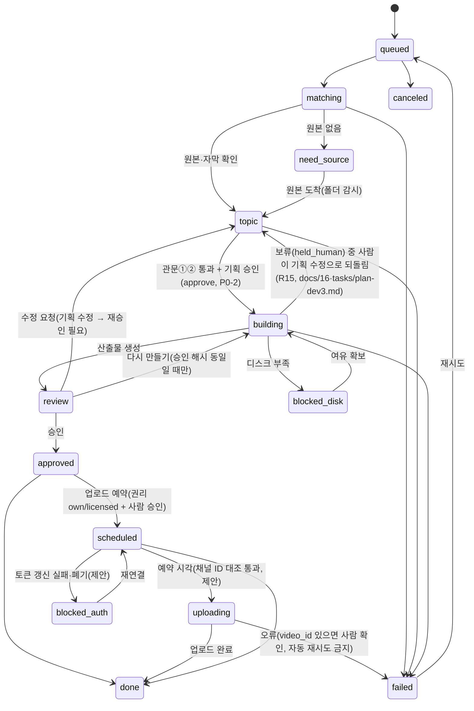

# 01. 작업 상태머신과 데이터 모델

> 기준일 2026-11-01. 코드는 요청 시 작성한다. 이 문서는 구현 전 합의용 설계다.

## 1. 실행 구조

| 구성 | 포트 | 역할 |
|---|---|---|
| 레이더/대시보드 서버 | 8765 (127.0.0.1 고정) | 화면, 데이터 조회, 사람 조작(승인·큐 조작 POST) |
| 워커 | 없음 (듣는 포트 없음) | 작업 큐 실행, Claude 호출, ffmpeg, 받아쓰기. 서버와는 SQLite로만 통신([docs/16 ADR-005](16-기술설계ADR.md)) |
| 런처(`launch-dashboard` 스킬) | — | 서버 상태 확인 → 켜져 있으면 창만 열기, 꺼져 있으면 기동 |

- 화면(서버)과 실행(워커)을 프로세스로 분리해, 제작이 길어져도 화면이 멈추지 않는다.
- **워커 동시 실행 수 = 1** (GPU 받아쓰기와 인코딩 충돌 방지). 설정값으로 둔다.
- 실행 주체 순서: 단계 0 Claude 데스크탑 수동 → 단계 1부터 Claude Code 헤드리스 호출.
- Claude 호출은 **작업 단위로 분리**한다(소재 선정 / 흐름·후킹·제목 / 지시서 / 자막). 재시도와 로그가 쉬워진다. 긴 자막은 호출마다 **처음부터 끝까지** 읽게 한다(C1-3).

## 2. 작업(Job) 상태머신



| 상태 | 설명 | 진행바 단계 |
|---|---|---|
| `queued` | 접수됨 | 소재 |
| `matching` | 작품·원본·자막·권리 확인 | 원본 |
| `need_source` | 원본 없음, 폴더 감시 대기 | 원본 |
| `topic` | 소재 후보 3개 → 사용자 선택(관문 ①②) | 소재 |
| `building` | 받아쓰기, 지시서, 자막, 미리보기 | 제작 |
| `blocked_disk` | 여유 N GB 미만이라 보류 | 제작 |
| `review` | 승인 대기(영상 확인·캡컷 마무리) | 검수 |
| `approved` | 승인됨 | 업로드 |
| `uploading` (제안) | 업로드 진행 중: 세션 URI·`video_id` 저장, 자동 재시도 금지([docs/14 §6-2](14-환경설정과대기큐.md)) | 업로드 |
| `blocked_auth` (제안) | 구글 토큰 갱신 실패·폐기로 업로드 보류([docs/14 §6-3](14-환경설정과대기큐.md)) | 업로드 |
| `scheduled` | 업로드 예약됨 | 업로드 |
| `done` / `failed` / `canceled` | 종료 | — |

- 모든 상태 변경에 **타임스탬프와 로그**를 남긴다(`job_events`). "소재 선정 · 완료 · 11분 7초" 표시의 원천이다.
- `scheduled` 로 가는 조건: ① `rights_status ∈ {own, licensed}` ② 사람이 승인 버튼을 눌렀을 것 ③ 옵션 "업로드 예약까지 한 번에"가 켜져 있어도 ①②를 우회하지 않는다.
- `blocked_disk`: 작업 시작 시 `디스크 여유 < max(10GB, 원본 크기 × 2)` 이면 진입. 사용자 알림 후 보류한다.
- 워커 전이(`queue_state`·`hold_reason`, 큐 규칙은 [docs/16 ADR-005](16-기술설계ADR.md)):
  - 집기: `building` + `waiting`만 → `running`. 기동 시 남은 `running`은 `waiting`으로 복구(`job_events` 기록).
  - 사람 확인: 승인 해시 불일치·`plan_hash` 미기록·원본 경로 위반·엔진 종료 1(`[P0-`)·inspect 차단·산출물 없음 → `building` 유지 + `held_human` + `hold_reason`(사유).
  - 성공: 산출물 기록과 함께 `building → review` + `held_human` + `hold_reason='검수 대기'`.
  - 실패: 경로 거부·컷표 없음·컷표 읽기 실패·엔진·inspect 오류·시간 초과·워커 내부 오류 → `failed` + `finished`.

## 3. 데이터 모델

### works (작품)
작품명, 별칭[], 장르, 원본 폴더 경로, 회차 수, 자막 보유 회차[]

### sources (원본 파일)
| 필드 | 설명 |
|---|---|
| work_id, episode | 작품·회차 |
| file_path, srt_path, duration_sec | 파일 정보 |
| **origin** | `local_file` / `own_youtube` / `licensed` / `external_youtube` |
| **rights_status** | `own` / `licensed` / `unverified` |
| rights_note | 라이선스 출처·계약 메모(자유 텍스트) |

- `rights_status = unverified` → 업로드 예약 기능 자동 차단. 영상 제작까지만 허용(R9-1).
- `origin = external_youtube` 기본 `rights_status = unverified`.

### links (입력 링크 — 단계 2부터)
URL, 수집 메타(제목·채널·설명·썸네일·조회수), 매칭 작품, **매칭 신뢰도**, 매칭 근거

| 신뢰도 | 처리 |
|---|---|
| 높음 | 자동 진행 |
| 중간 | 사람이 작품 확인 후 진행 |
| 낮음 | 진행 차단, 작품명 수정 요구 |

근거: 제목·설명·해시태그·출연진 텍스트. **설명란이 비어 있으면 낮음.** 링크는 레퍼런스 분석 전용이며 영상 자체를 소스로 쓰지 않는다(R9-2).

### jobs (제작 작업) — 링크와 1:N
link_id(nullable), source_id, **rule_set**[], topic_mode, channel_id, speed(`fast`/`review`), upload_option, 상태, 시작·종료 시각
대기 큐 필드(제안): `queue_state`, `priority`, `slot_id`, `hold_reason` — 규칙은 [docs/14 §4](14-환경설정과대기큐.md). 업로드 필드(제안): `upload_session_uri`, `video_id`([docs/14 §6-2](14-환경설정과대기큐.md)).

### job_events
job_id, 상태 전이, 시각, 메시지, 렌더 횟수, 오류

### topics (소재 기록)
job_id, 원본 구간, 후킹 대사, 제목, **결 태그(주·보조)**, 점수, 사용 여부(`used`)

### outputs
편집지시서·자막.srt·나레이션·미리보기·체크리스트 경로, 점검표 결과(✓/△/✗ 개수), `rule_exceptions`

### capcut_logs (시각 오차 기록)
job_id, 보정한 컷 수, 최대 보정 초, 소요 분, 메모 → 규칙의 여유값(0.1/0.2초) 개선 근거

### channels
채널명, 업로드 설정, 기본 구성, 업로드 허용 여부(기본 `false`)
구글 계정별 채널 등록 제안(`yt_channels`)과 합칠지는 [docs/14 §3·§8](14-환경설정과대기큐.md).

## 4. 제작 옵션 기본값

| 옵션 | 기본 | 비고 |
|---|---|---|
| 속도: 패스트(검수 생략) | 꺼짐 | 켜도 권리 게이트·자가 점검은 유지 |
| 속도: 검수 후 승인 | **켜짐** | 소재·제목 관문에서 사람이 고름 |
| 업로드 예약까지 한 번에 | **꺼짐** | 영상까지만 만들고 보관함에서 승인 대기 |
| 원본 들어오면 자동 제작 | 켜도 됨 | 폴더 감시. 업로드는 아님 |
| 채널 | 필수 | |

## 5. 원본 폴더 규칙

```
원본/<작품명>/E01.mp4
원본/<작품명>/E01.srt
```
이름 규칙이 매칭과 폴더 감시를 단순하게 만든다. 자체 보유 콘텐츠는 `원본/<채널명>/<영상제목>.mp4`.

## 6. 갱신 방식

- 단계 1~2: 3초 폴링.
- 단계 3 이후 작업이 늘면 **SSE 또는 Supabase Realtime** 으로 교체(서버 부하).
