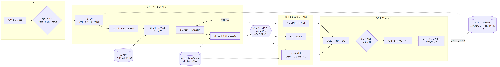
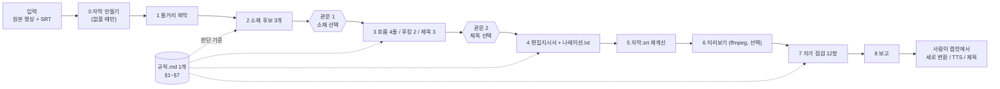
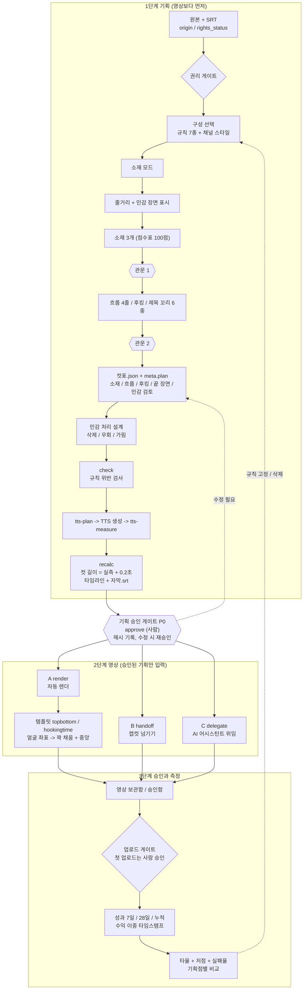
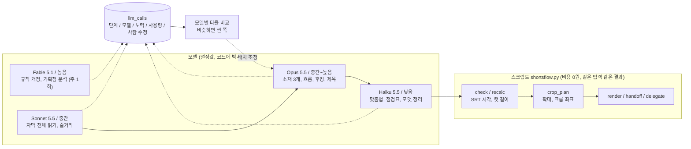
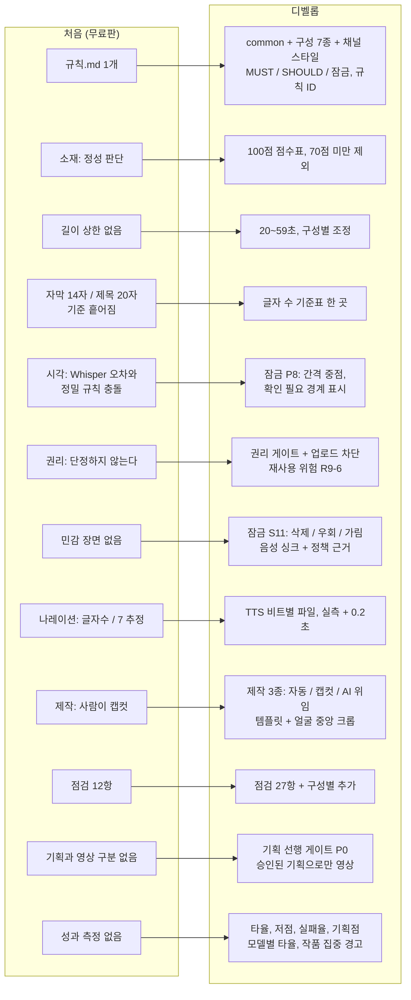

# 09. 처음 기획 vs 디벨롭 기획 — 다이어그램

- **처음 기획:** 영드짜 무료판 (`_원본_무료판/SKILL.md` 0~8단계 + `규칙.md` §1~§7)
- **디벨롭 기획:** 현재 폴더 전체 (`skills/`, `rules/`, `modes/`, `engine/`, `docs/01~10`), v10까지 반영

**이미지 파일:** `docs/img/` (PNG + 원본 `.mmd`)

## 1. 처음 기획 — 한 줄로 흐르는 스킬

**특징:** 규칙 한 파일, 드라마 한 구성, 길이 상한 없음, 정성 판정, 권리는 문구 한 줄, 소리·화면 템플릿·성과 측정 없음. 기획과 영상 단계의 구분이 없다(지시서와 자막을 한 흐름에서 바로 만든다).

## 2. 디벨롭 기획 — 기획 선행 게이트 + 엔진 + 측정 루프

**핵심 변화:** 영상 단계는 승인된 `컷표.json` 해시와 일치할 때만 실행된다. 영상 단계에서 소재·컷·문장을 새로 정하지 않는다(P0-3).

## 3. AI 직원 구조 (v10) — 판단은 모델, 계산은 스크립트

## 4. 항목별 변화 매핑 (처음 → 디벨롭)

## 5. 요약 표

| 영역 | 처음 (무료판) | 디벨롭 | 근거 문서 |
|---|---|---|---|
| 구조 | 스킬 1 + 규칙 1 | 스킬 + 규칙 9 + 모드 + 엔진 + 문서 10 | README |
| 진행 순서 | 한 흐름으로 바로 영상 | **기획 → 승인 게이트 → 영상** | `common` §0-2, `docs/06` |
| 규칙 운용 | 문장형 | MUST / SHOULD / 잠금, ID 인용, 예외 기록 | `common` §0 |
| 소재 | 후보 3개, 정성 | 100점 점수표, 결 태그, 소재 모드 | `common` §1, `modes/` |
| 소리 | 캡컷에서 TTS | 비트별 TTS, 실측, 재계산 | `common` §10-2 |
| 화면 | 캡컷에서 세로 변환 | 템플릿 2종, 얼굴 중앙 + 꽉 채움 | `docs/06`, `docs/07` |
| 안전 | 저작권 문구 한 줄 | 권리 게이트, 민감 처리, 정책 근거 | `common` §9·§11, `docs/05` |
| 제작 | 사람 | 자동 / 캡컷 / AI 위임 | `docs/06`, `docs/08` |
| AI 운용 | 모델 지정 없음 | 판단은 모델 단계별, 계산은 스크립트, `llm_calls` | `docs/10` |
| 운영 | 없음 | 상태머신, 보관함, 승인 게이트 | `docs/01`, `docs/03`, `docs/08` |
| 측정 | 없음 | 타율, 저점, 실패율, 기획점, 성과 지연 반영 | `docs/08`, `docs/10` |

## 6. 아직 처음 수준에 머문 부분

| 항목 | 상태 |
|---|---|
| 컷표.json 자동 생성 | 사람이 작성 (스킬은 절차만 안내) |
| 얼굴 자동 검출 / 화자 판정 | 미구현 (좌표 수동 입력) |
| TTS 자동 호출 (MiniMax API) | 미구현 (mp3 수동 생성) |
| `llm_calls` 기록, 모델 배치 설정 | 설계만, 코드 없음 |
| 대시보드 / 승인함 / 보관함 / 성적표 UI | 설계 문서만 |
| 레이더 / 성과 수집 | 설계 문서만 |
| 실제 영상 검증 | 합성 샘플만 검증 |
| `indie.md` | 정의 전 빈 슬롯 |
