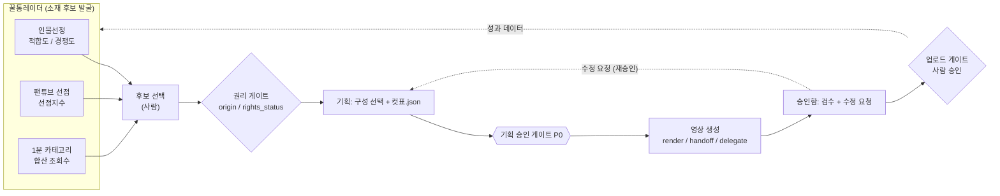

# 12. 꿀통레이더 세부 모듈 (인물선정 · 팬튜브 선점 · 1분 카테고리)

전달받은 스크린샷 분석 3건을 설계에 반영한 문서다. 로드맵상 **5단계(레이더)** 의 상세 설계(docs/04).
**수치와 화면은 전달값이며 내가 검증한 것이 아니다.** 아래 §5에 "그대로 채택하지 않은 것"을 따로 적었다.

## 1. 레이더의 역할 = 소재 후보 입력

레이더는 영상을 만들지 않는다. **"무엇을 만들지"를 고르는 입력 단계**이고, 선택된 후보는 기존 파이프라인(권리 게이트 → 기획 → 승인 → 영상)으로 들어간다.
레이더 카드 → 원클릭 제작 폼으로 넘기는 흐름(STEP 1~6)은 [docs/13](13-원클릭제작흐름.md).

## 2. 모듈 3종

### 2-1. 인물선정 — 스타/셀럽 후보

| 화면 요소 (전달값) | 설계 |
|---|---|
| 인물 카드: 대표 숏폼 썸네일 + 실제 조회수 | `radar_person_clips`: 영상 ID, 조회수, 조회 시점 |
| **적합도 점수** (예: 103.0, 97.5, 82.5) | `fit_score` — 산식은 **전달 자료에 없음**(§4에서 우리 산식 제안) |
| **경쟁도 지수** (예: 21.8/100) | `competition_index` |
| 경쟁 채널 규모 분포, 30/90일 지표 | `radar_competitors`: 채널, 구독 규모 구간, 30일/90일 조회 |
| 퀵 액션: 소스 탐색 바로가기, 네이버, 구글 트렌드 | 외부 검색 링크 모음(자동 수집이 아니라 **바로가기**) |

구성 규칙은 `rules/person-fantube.md`(초안).

### 2-2. 팬튜브 선점 — 아이돌·팬덤

| 화면 요소 (전달값) | 설계 |
|---|---|
| 그룹·아티스트 검색 + 유튜브 검색 바로가기 | 키워드 → 후보 목록 |
| **선점지수** 카드 (전달 예: 59.1 / 38.4 / 49.1) | `preempt_index` + 대표 숏폼 |
| 데이터 탭: DC갤, 꿀게, 타사, 구글 검색, 나무위키 | `radar_sources`: 출처 유형, 수집 방식(공식 API / 수동), **약관 확인 상태** |

- 전달 예시 중 대표 숏폼 제목 일부(예: 《우리 가 상한국이 돼요》)는 글자가 불분명해 **오독 가능성**이 있다. 원문은 화면에서 확인한다.

### 2-3. 1분 OO 카테고리 발굴 — 영드짜/예짜 밖 장르

| 카드 (전달값) | 설계 |
|---|---|
| 1분수영 1,676만 / 1분배드민턴 2,934만 / 1분탁구 1,638만 (합산 조회수) | `radar_categories`: 카테고리, 세부 숏폼 4종, 합산 조회수, 조회 시점 |
| 시즌 공백기에 채널 다각화 | 후보 목록에서 구성 `variety`(웃음·리액션) 또는 신규 구성 후보 |

합산 조회수는 **상위 영상 몇 개의 합**이라 카테고리의 평균 성과가 아니다. 영상 수·기간을 함께 저장한다.

## 3. 데이터 모델 (추가)

| 테이블 | 핵심 필드 |
|---|---|
| `radar_snapshots` | 수집 시각, 모듈, 소스, 수집 방식(공식 API / 수동 입력) |
| `radar_persons` | 이름(공개된 활동명), 분야, `fit_score`, `competition_index`, 스냅샷 ID |
| `radar_person_clips` | person_id, 영상 ID·제목, 조회수, `views_at` |
| `radar_competitors` | person_id, 채널, 규모 구간, 30/90일 조회 |
| `radar_fandom` | 아티스트/그룹, `preempt_index`, 대표 영상 |
| `radar_categories` | 카테고리명, 합산 조회수, 영상 수, 기간, 세부 영상 |
| `radar_sources` | 출처 유형, 수집 방식, `tos_status`(확인함/미확인/금지) |
| `topics.radar_ref` | 후보가 어떤 레이더 카드에서 왔는지 → 성과와 연결(레이더 정확도 측정) |

## 4. 점수는 우리 데이터로 만든다 (제안, 미검증)

전달 자료는 점수의 **값**만 보여 주고 **계산식을 알려 주지 않는다.** 같은 숫자를 흉내 내지 않고, 우리가 설명할 수 있는 산식으로 시작한다.

| 지표 | 제안 정의 | 비고 |
|---|---|---|
| 후보 성과 | 최근 30일 해당 주제 상위 영상 N개의 **7일 조회 중앙값** | 평균 금지(대박 왜곡), docs/10 지표 |
| 경쟁도 | 같은 주제를 올리는 채널 수와 상위 채널 집중도 | 0~100으로 정규화 |
| 후보 점수 | 후보 성과 정규화 × (1 − 경쟁도/100) | **가중치는 임시**, 첫 20편 후 우리 타율로 보정 |

- 레이더 추천이 실제로 타율을 올리는지는 `topics.radar_ref` 로 **레이더 사용/미사용 타율을 비교**해 확인한다(단계 5 검증 기준, docs/04).
- 점수가 높아도 **권리 게이트를 면제하지 않는다.**

## 5. 전달 내용 중 그대로 채택하지 않은 것

| 전달 내용 | 우리 판단 |
|---|---|
| 파이프라인 끝이 "자동 예약 업로드" | **채택하지 않음.** 업로드는 항상 사람 승인(R9-1, docs/08 §3). 기획 승인 게이트(P0)도 유지 |
| "자연어 잡도리(5차 수정)" | 승인함의 **수정 요청 → 재승인** 루프(P0-2)로 흡수. 컷표를 고치면 재승인 필요 |
| DC갤·나무위키·구글 검색 수집 | **스크래핑은 약관·차단 위험**. 공식 API 우선, 수동 입력 병행. 소스마다 `tos_status` 확인 후에만 자동 수집 |
| 점수 알고리즘 | 공개 안 됨 → §4 자체 산식으로 대체 |
| 외부 작품·인물 소재 | 권리·초상·명예 문제는 레이더 점수와 무관하게 남는다 → `rules/person-fantube.md`, `rights_status` |

## 6. 화면 (3구간)

| 구간 | 레이아웃 |
|---|---|
| 데스크톱 1200~ | 좌측 모듈 탭(인물 / 팬튜브 / 1분 카테고리), 중앙 카드 그리드 4~5열, 우측 후보 바구니(선택한 후보 → 만들기) |
| 태블릿 768~1199 | 카드 3열, 후보 바구니는 하단 드로어 |
| 모바일 ~767 | 카드 2열 스와이프, 하단 고정 "후보 담기" 44px 이상 |

| 요소 | 모바일 | 태블릿 | 데스크톱 |
|---|---|---|---|
| 카드 제목 | 14px | 15px | 16px |
| 점수 숫자 | 24px | 28px | 32px |
| 카드 메타(조회수, 시점) | 12px | 12px | 13px |
| 탭 라벨 | 13px | 14px | 14px |

모든 카드에 **조회 시점**을 표시한다(조회수는 계속 변한다, docs/08 §6).

## 7. 로드맵 위치와 린 검증

- 단계 5(레이더) 앞에 **수동 입력 레이더**부터: 시트에 후보·조회수·경쟁 채널 수를 직접 적고 `topics.radar_ref` 만 연결해 본다.
- 외부 분석 도구(docs/10 §7)로 먼저 후보를 찾고, 쓸모 있던 정보만 구현한다.
- 황금키워드는 레이더의 탭(S-RD5)으로 둔다(별도 메뉴 아님). 근거·채택 이유는 [docs/15 §2](15-커리큘럼반영.md).
- **인물·팬튜브·1분 카테고리는 영드짜(드라마) 구성 규칙과 다르다.** 첫 검증은 자체 보유 소스(`own-content`)로 하고, 외부 인물·카테고리는 별도 경고와 권리 확인을 붙인다.
